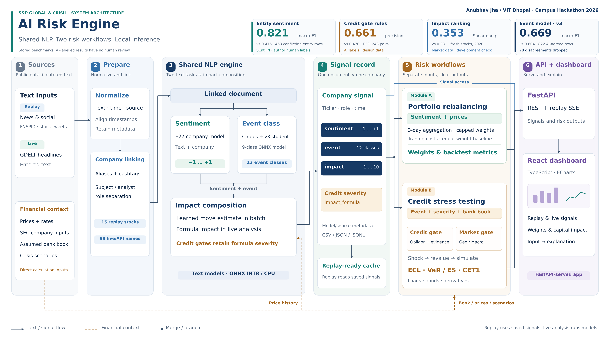

# AI Risk Engine: From News & Social Sentiment to Portfolio and Credit Risk

**Submission for the S&P Global & CRISIL Campus Hackathon 2026**

| Detail | Information |
|---|---|
| **Candidate Name** | Anubhav Jha |
| **College Email ID** | anubhav.23bai11112@vitbhopal.ac.in |
| **College / Campus** | VIT Bhopal |
| **Demo Video Link** | https://vercel.com/anubhav-jhas-projects-6003010f/landing-page-bank|
| **Slide Deck Link** | https://docs.google.com/presentation/d/1FT8_KLupz0IJT5HMbO_TSWoIdaK4OYzoQY8jl74XQfY/edit?usp=sharing — `docs/presentation.pdf` |

## 1. Project Overview / Problem Statement & Approach

**AI Risk Engine** turns financial news and social posts into company, sentiment, event and impact signals. Rules and financial calculations connect those signals to two prototype risk workflows.

- **Module A — Portfolio Rebalancing:** Uses historical sentiment signals to adjust the weights of a simulated portfolio of 15 S&P 100 stocks. It compares sentiment-based allocation against an equal-weight benchmark.
- **Module B — Credit Stress Testing:** Uses a credit gate and a separate Geopolitical/Macroeconomic market gate to trigger stress analysis on a hypothetical bank portfolio of loans, bonds and derivatives. It estimates credit losses and capital impacts under historical crisis scenarios and configurable what-if assumptions.

The dashboard includes historical replay and a live GDELT news interface. Measured results and limits are below; full details are in [RESULTS](docs/RESULTS.md) and [EXPERIMENTS](docs/EXPERIMENTS.md).

## 2. Architecture & Tech Stack

### Product Architecture



**End-to-end data flow:**

1. **Data sources:** Financial news, social media posts, historical stock prices, company debt information, credit ratings and macroeconomic data.
2. **Ingestion and preprocessing:** Cleans text, identifies company references and prepares documents for inference.
3. **NLP signal generation:** New pipeline scoring defaults to E27 company-specific sentiment (`sentiment = "entity"`), with the older `own` model as fallback when the company name is missing. Events use E24 candidate C (`events = "model_rules"`); impact uses a formula.
4. **Shared signal layer and API:** Exposes signals through FastAPI. Stored credit-replay signals still contain `own` sentiment, because entity scoring missed a real downgrade alert. The credit gate and a separate Geopolitical/Macroeconomic market gate feed Module B.
5. **Risk modules:** Module A computes portfolio weights and backtest metrics. Module B applies financial formulas, historical shocks and statistical simulation to estimate credit losses and capital impacts.
6. **Dashboard:** A React and TypeScript interface displays signals, replay progress, portfolio weights, credit alerts and stress-test outputs.

Historical prices, company financials and bank-book exposures enter the relevant risk calculations separately; they are not generated by the NLP models.

### Tech Stack

| Layer | Technologies |
|---|---|
| Backend and API | Python 3.12, FastAPI |
| NLP and model training | PyTorch, Hugging Face Transformers |
| CPU inference | ONNX Runtime, INT8 quantization |
| Frontend | React 19, TypeScript, Tailwind CSS, ECharts, Vite |
| Data processing | pandas, NumPy, CSV and JSONL |
| Data sources | FNSPID, public stock-tweet datasets, yfinance, SEC EDGAR XBRL and FRED |
| Development and testing | uv, pytest, Ruff, npm |

The credit-risk module is primarily rules-, formula- and simulation-based; it is not presented as a trained credit-risk ML model.

## 3. Dataset Used

The project uses publicly available financial text and market data. No confidential client data is used. The bank portfolio used in Module B is hypothetical.

### Data sources

| Dataset / Source | Purpose |
|---|---|
| FNSPID financial news headlines | Historical text analysis and impact-model research |
| Stock tweets from Kaggle and Hugging Face | Social sentiment, signal generation and historical replay |
| Twitter Financial News Sentiment (TFNS) | Sentiment-model evaluation |
| Twitter Financial News Topic (TFN-topic) | Event-classification evaluation |
| Financial PhraseBank and FiQA-2018 | Additional sentiment training and cross-dataset evaluation |
| SEntFiN | Entity-aware sentiment training and evaluation; human labels supplied by the dataset authors |
| Daily prices and S&P 500/VIX data via yfinance | Event studies and portfolio backtesting |
| SEC EDGAR XBRL and credit-rating evidence | Company debt information and credit-risk inputs |
| FRED and historical market data | Macroeconomic inputs and stress scenarios |
| [Financial Transactions Dataset: Analytics (Kaggle)](https://www.kaggle.com/datasets/computingvictor/transactions-fraud-datasets) | Separate synthetic merchant-flow sleeve; license: see the dataset page |

### Historical window and assumptions

The primary integrated replay and portfolio backtest use **9 April–10 June 2020**, with 14,169 sampled text documents and 15 stocks. The historical window is constrained by the available news and market data.

Module B's main book uses SEC inputs and is dated 31 December 2019, with 85 positions across 15 companies and approximately $2.96 billion in loan and bond exposure. Its exposures, hedge positions, loss-given-default assumptions and initial capital are modelling assumptions rather than records from a real bank.

A separate [transaction-seeded sleeve](docs/MODULE_B_TRANSACTIONS.md) uses monthly merchant purchase flows from the public transaction dataset. Its loans, bonds, hedges and rating buckets are synthetic proxies; the ratings are not real credit ratings. Merchant IDs are not mapped to real companies. The aggregated sample can rebuild this sleeve without the raw download. Its stress results are stored separately; the dashboard, alerts and existing backtests still use the SEC book.

Historical scenarios include the Global Financial Crisis, the Eurozone crisis and COVID-19. These are stress-testing scenarios, not forecasts. Some market and hedge risks remain simplified or outside the current model.

Dataset licences and known data-quality issues are documented in the project. In particular, the Kaggle tweet source contains duplicated records across certain tickers, and some public training datasets overlap with their original test sets. The relevant experiments account for identified overlap where documented.

All new project labels for E24 (including D1/D2 and the final sets), Macro/Geo adjudication and the 8-K credit set are **AI-made or AI-adjudicated by ChatGPT and Claude, with no human check**. Their provenance includes `ai_agreed`, `ai_agreed_ai_audited` and `ai_adjudicated`; none means human review. SEntFiN supplies the human-made reference labels for E27. See [label provenance](docs/RESULTS.md#label-provenance).

## 4. Quickstart & Installation

**Runtime:** Python 3.12 and Node.js 22 for the dashboard.

**Tested environment:** Linux development environment. The project also includes CI checks; verify the current repository's supported platforms before relying on a different operating system.

### Prerequisites

- Git
- Python 3.12
- [uv](https://docs.astral.sh/uv/)
- Node.js 22 and npm for the dashboard

### Clone and install

```bash
git clone <YOUR_PUBLIC_REPOSITORY_URL>
cd <YOUR_REPOSITORY_FOLDER>

uv sync
```

### Run the command-line demo

```bash
uv run python run_demo.py
```

This uses the saved `own`-sentiment signals. The separate entity-sentiment comparison is saved in `data/outputs/signals_entity.jsonl.gz`; changing the config default does not replace the stored credit signals.

### Run the complete dashboard and API

Build the frontend and start the combined server:

```bash
cd web
npm install
npm run build
cd ..

uv run uvicorn riskengine.site:app --host 127.0.0.1 --port 8000
```

Open the following URLs:

- **Dashboard:** http://127.0.0.1:8000/
- **API documentation:** http://127.0.0.1:8000/api/docs

The dashboard includes the overview, per-stock engine view, headline analysis, historical live replay and Module A pages. The live GDELT interface is available at `/live` when using the corresponding dashboard route or endpoint configured by the application.

For frontend development with hot reload, run the API separately:

```bash
uv run uvicorn riskengine.api:app --port 8000
```

In another terminal:

```bash
cd web
npm install
npm run dev
```

The development dashboard is served by Vite, normally at http://localhost:5173.

### Run tests

```bash
uv run ruff check .
uv run ruff format --check .
uv run pytest -q
```

For frontend checks:

```bash
cd web
npm run lint
npm run build
```

**Data and model notes:** The repository contains small samples and derived outputs. Full raw datasets and model files may require separate downloads or setup according to the repository documentation. Some evaluation and demo workflows use precomputed outputs to avoid unnecessary downloads.

## 5. Results and Limits

### Entity-aware sentiment (E27)

On SEntFiN's Indian business news with human labels, macro-F1 rose from **0.476 to 0.821** on 463 entity rows from conflicting headlines: gain **+0.344**, 95% range **0.295 to 0.400**. Across all 2,152 rows, it rose from **0.675 to 0.864**. The registered switch rule passed; the config default is now `entity`.

A small, post-hoc FiQA US check (150 rows) gave Spearman **0.582 to 0.623** and sign accuracy **0.731 to 0.787**. This does not establish broad US news or tweet performance. Full results and seed-record limits are in [RESULTS](docs/RESULTS.md#entity-aware-sentiment-e27).

### Event classification

The running engine is **E24 candidate C (rules + event model)**. Its final test was run once, against the previous engine A. Macro-F1 uses all 12 event classes:

| Final set | Rows | Previous engine A | Running candidate C | Gain | 95% range of gain |
|---|---:|---:|---:|---:|---|
| News | 200 | 0.309 | 0.376 | +0.067 | +0.029 to +0.107 |
| Tweets | 100 | 0.142 | 0.132 | -0.010 | -0.031 to +0.009 |

The tweet result is inside the registered margin; it is not an improvement. Eight of the 12 classes are absent in tweets. Every evaluation label for these final sets is **AI-made**: ChatGPT, Claude and AI adjudication, with **no human check**. Development sets D1 and D2 are also AI-derived. See the [results file](data/outputs/e24_final_results.json) and [labelling amendment](docs/E25_LABELLER_AMENDMENT.md).

Earlier TFNS sentiment and TFN-topic component benchmarks are kept separately in [RESULTS](docs/RESULTS.md); they are not scores for the new entity model or the credit gate.

### Credit and market alerts

On the wider 8-K set (287 headlines), frozen C had recall **0.871** and precision **0.842**. ChatGPT and Claude agreed on **86.8%** of labels; Claude's label was used where they differed, so the adjudicator was also a labeller. All labels are AI-made, with no human check. This Default-heavy sample and E23 are **not comparable**; E23 precision **0.47** remains the reported worst case.

Entity scoring reduced replay credit alerts **4 to 2**: it removed a false BAC alert but also missed a real Boeing downgrade. The credit chain therefore keeps the stored `own` scores. The market gate produced 15 alerts on that stored replay; an earlier non-blind read of 16 alerts found about 70% market-wide, an exploratory check only. See [RESULTS](docs/RESULTS.md#module-b-alert-gates).

### Module A portfolio comparison

For 9 April–10 June 2020, with the same allocation rule and costs:

| Strategy | Total return | Sharpe ratio |
|---|---:|---:|
| Equal-weight benchmark | 25.52% | 4.88 |
| Entity-sentiment tilt | 24.85% | 4.73 |

With 1,000 shuffled-company placebos, p was **0.403 for return** and **0.380 for Sharpe**. The tilt shows **no proven value over chance or equal weight**. Sources and the earlier `own` comparison are in [RESULTS](docs/RESULTS.md#module-a-portfolio-and-placebo).

### Impact score (v3) and alert validation

The impact score is now a learned expected price move (clipped ridge on past headlines and the real two-day abnormal move), used for news and tweets. Spearman rank match with the real move, volatility-only baseline in brackets: fresh stocks 2019 **0.280** (0.143), 2020 **0.353** (0.331); our stocks 2019 **0.327** (0.270), 2020 **0.381** (0.340). The earlier version (v2) failed in 2020 (-0.092); v3 fixes that. On tweets (test 1 Jun to 16 Jul 2020) it reaches 0.140 vs 0.134 for volatility only and 0.011 for the old formula. 2019 and 2020 were already seen during development, so this is a development check, not a blind test. Details: [IMPACT_V3](docs/IMPACT_V3.md).

The credit gate keeps the severity formula, because the learned score says how far a stock may move, not how serious a credit event is; with the learned score the gate dropped real downgrades. We also tested whether the learned score could trigger non-credit alerts. At the same number of alerts it was no better than choosing the most volatile stocks (precision 0.076 vs 0.067 in 2019, 0.411 vs 0.428 in 2020), so Module B stays on the credit and market-wide gates. A big price move shows that the market reacted, not that a crisis happened. See [E30](docs/E30_TRIGGER_VALIDATION.md).

### Other limits

The learned impact beats volatility only for ranking, not for choosing alerts; `/analyze` still uses the formula because it has no price history. Credit gating still needs broader independent validation. The hypothetical bank book simplifies interest-rate, funding and hedge risks. Historical results are prototype outputs under these assumptions, not forecasts or production risk estimates.

## License

This project is released under the MIT License. See [`LICENSE`](LICENSE) for details.
